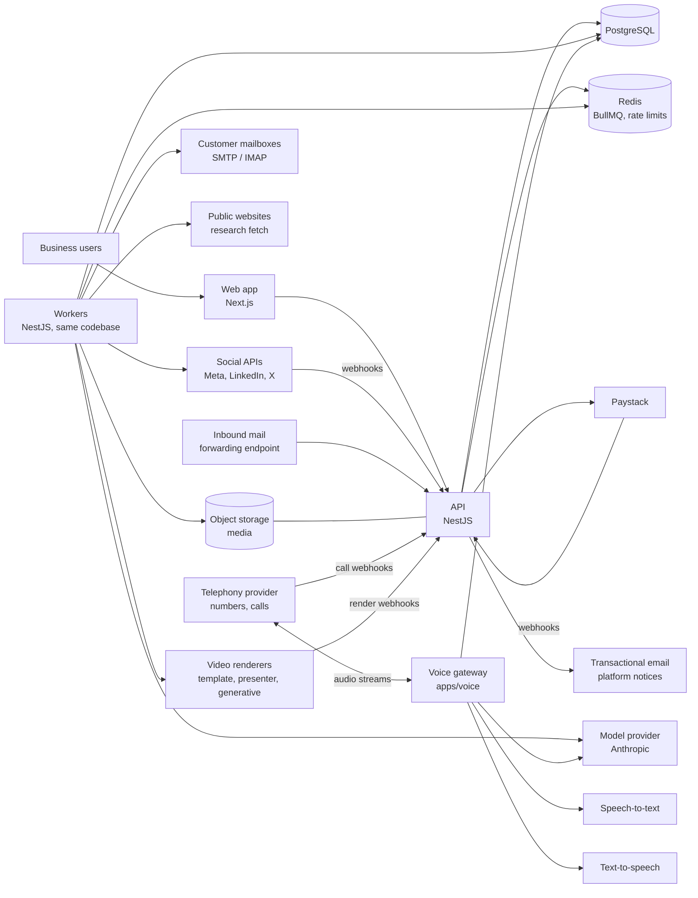

# Architecture

Status: draft v1, 2026-10-29.

## 1. Principles

1. **The model proposes; the platform decides.** Sending, publishing, spending, suppression and permissions are
   deterministic code. A model's output is data that passes validation and guardrails before anything happens.
   (Proven in KudiBooks: `SalesAgentWorkerService` + `SalesAgentModelService`.)
2. **Roles are definitions.** The platform knows about tasks, connectors, autonomy and budgets. It does not know
   what "social media" is. A role package declares its tasks; the platform runs them. See
   [ROLE-FRAMEWORK.md](ROLE-FRAMEWORK.md).
3. **Every row belongs to a workspace.** Tenancy is enforced in the data layer, not remembered in each query.
4. **At-least-once jobs, at-most-once side effects.** Jobs may retry; sends and publishes go through intents with
   idempotency keys and are never retried automatically when the outcome is uncertain.
5. **Money before model.** No model call without a budget reservation; settle actual cost after.

## 2. System context



Voice and video details: [VOICE.md](VOICE.md), [VIDEO.md](VIDEO.md).

## 3. Repository layout

```
ai-staff/
  apps/
    api/            NestJS HTTP API (controllers, guards, webhooks)
    worker/         NestJS standalone app: BullMQ processors and schedulers (same packages as api)
    voice/          realtime voice gateway: telephony media streams, STT → LLM → TTS turn loop (stateful per call)
    web/            Next.js app (marketing site + product, live call listen/take-over via WebRTC)
  packages/
    core/           platform domain: workspaces, staff, tasks, approvals, autonomy, budgets, activity
    roles/
      social-media/ role definition + task handlers + prompts
      sales-manager/
    connectors/     connector interface + implementations (meta, linkedin, x, tiktok, youtube, smtp-imap)
    voice/          telephony, STT, TTS adapters; turn loop; realtime tools
    media/          renderer adapters, TTS voiceover, stock/music, transcoding (FFmpeg), C2PA, asset manifests
    llm/            ModelProvider port, Anthropic adapter, fake adapter, pricing
    billing/        plans, metering, Paystack client
    contracts/      zod schemas shared by api, worker and web
    config/         typed config (zod-validated env)
    db/             TypeORM entities, migrations, tenant-scoped repository helpers
  docs/
```

API and worker are separate deployables built from the same packages, so web traffic and background work scale
independently and a slow model call never holds an HTTP request (except the explicit "suggest now" endpoints).

## 4. Core components

### 4.1 Workspace and identity
Users, workspaces, memberships (owner/admin/member), invitations, sessions (JWT access + rotating refresh),
optional TOTP MFA. Every authenticated request resolves `workspaceId`; guards enforce membership and role.

### 4.2 Company brain
One structured profile per workspace (`company_profiles` + `company_facts`): offerings, approved offers/prices,
voice, audience, banned claims, allowed link domains, escalation contact. Versioned: every task records the profile
version it used, and editing the profile invalidates unsent drafts that relied on a changed fact (as KudiBooks does
for stale knowledge drafts).

### 4.3 Staff members
A `staff_member` is an instance of a role in a workspace: display identity (name, signature, disclosure mode),
role-specific settings (validated by the role's settings schema), connected accounts, schedule, state
(`draft → probation → active ⇄ paused → archived`, plus `needs_attention`).

### 4.4 Task engine
- A **task type** is declared by a role (e.g. `social.draft_post`, `sales.first_email`).
- A **task run** is one execution, stored in `task_runs`, executed by BullMQ.
- Triggers: schedule (cron per staff member), event (inbound reply, social comment, lead created, approval
  granted), or a person ("suggest now").
- Each run: load context → policy check → reserve budget → call model (if needed) → validate output → guardrails →
  produce **work items** (drafts) or **side-effect intents** (send/publish) → settle → log activity.
- Errors: `Defer(until, reason)`, `Cancel(reason)`, or retryable failure with exponential back-off; dead after max
  attempts with an alert. (Same contract as KudiBooks' worker.)

### 4.5 Approvals and autonomy
- Every output of a task type at autonomy `draft` becomes a `work_item` in the approval inbox.
- Approve → the platform creates the side-effect intent. Edit → stored diff (used for promotion scoring).
  Reject → reason stored, fed back as negative examples to that staff member's future context.
- Autonomy per staff member × task type. Promotion rules are declared by the role; the platform evaluates them
  nightly and offers promotion; only a person can accept. Auto-demotion on complaint/bounce thresholds.

### 4.6 Side-effect intents
`send_intents` (email) and `publish_intents` (social) are created before any external call, with an idempotency key.
A dispatcher claims `pending` intents, performs the call, and records `sent`/`failed`. Intents found in `sending`
after a crash become `uncertain` and need a person. Never resent automatically.

### 4.7 Budgets and metering
- Two meters per workspace: **spend** (USD cost of model calls, research, connector fees) for the cap, and
  **work units** (role-declared, e.g. posts published, emails sent) for plan allowances.
- `usage_reservations` with `reserved → settled | released`, checked under a Postgres advisory lock per
  workspace (ported from `SalesAgentService.reserve/settle`). Expired reservations stop counting.
- Caps: plan allowance, workspace monthly spend cap (owner-set), per-staff daily cap.

### 4.8 LLM layer
`ModelProvider.callTool({ model, system, messages, tool, maxTokens, temperature, timeoutMs })` →
`{ input, usage }`. Anthropic adapter (forced tool use), fake adapter for tests and demo. Pricing table in the DB.
Model per task type is set in the role definition, overridable by platform admin. Untrusted text (prospect pages,
replies, comments) is always wrapped in tagged data blocks after the rules.

### 4.9 Connectors
```ts
interface Connector<Config, Capabilities> {
  kind: 'meta' | 'linkedin' | 'x' | 'smtp_imap';
  connect(input): Promise<ConnectedAccountSecret>;   // OAuth callback or credential check
  verify(account): Promise<HealthReport>;            // tokens valid, scopes present, DNS ok
  capabilities(account): Capabilities;               // what this account can do now
}
```
Capability interfaces (`Publisher`, `CommentReader`, `MessageReplier`, `MailSender`, `MailReader`) are what tasks
depend on, so a role never imports a specific network. Tokens are encrypted at rest (AES-256-GCM, key from secret
manager, per-row IV; ported from `token-crypto.ts` / `sales-agent-crypto.ts`). Health checks run daily; a broken
connector pauses dependent tasks and alerts.

### 4.10 Inbound
- Email replies: per-mailbox inbound webhook (forwarding from the customer's provider, or a Cloudflare email worker
  for platform-hosted addresses) and IMAP polling as fallback. Threading by `In-Reply-To`/`References`.
- Social: platform webhooks (Meta, etc.) verified by signature; polling where webhooks are unavailable.
- Every inbound item becomes an `inbound_event`, deduplicated by external ID, then fans out to the subscribed task
  types.

### 4.11 Activity and audit
`activity_events` (what staff did, for customers) and `audit_log` (what people did: approvals, settings, billing,
impersonation). Both append-only.

### 4.12 Voice gateway
A separate service for live calls. It holds one session per call, connected to the telephony media stream over
WebSocket. It runs streaming STT, the model with realtime tools, and streaming TTS, with barge-in. It loads a
read-only call context at start and writes `call_events` as it goes. Budget is reserved in blocks of minutes, and the
call ends gracefully when a block can't be extended. It scales horizontally on concurrent calls, with sticky routing
per call, and drains on deploy (no new calls; existing calls finish). See [VOICE.md](VOICE.md).

### 4.13 Media pipeline
Video ideas, scripts and storyboards are ordinary tasks. Rendering runs on the `media` worker pool: it submits to
the renderer, waits for its webhook or polls, transcodes with FFmpeg into per-network variants, embeds C2PA where
supported, stores everything in object storage, and records the asset manifest. See [VIDEO.md](VIDEO.md).

### 4.14 Billing
Plans, subscriptions, Paystack customer/plan/subscription codes, webhook processing (idempotent by event ID),
entitlement checks used by the task engine and hire flow. See [BILLING.md](BILLING.md).

## 5. Key flows

### 5.1 Scheduled task (e.g. weekly content plan, daily outreach)
```mermaid
sequenceDiagram
  participant S as Scheduler (worker)
  participant Q as BullMQ
  participant W as Task processor
  participant DB as Postgres
  participant M as ModelProvider
  S->>DB: due schedules (staff active, workspace entitled)
  S->>Q: enqueue task_run (jobId = staff:task:slot, dedup)
  Q->>W: run
  W->>DB: load context + policy check
  W->>DB: reserve budget (advisory lock)
  W->>M: callTool
  M-->>W: output + usage
  W->>DB: settle; validate + guardrails
  alt autonomy = draft
    W->>DB: work_item (approval inbox) + notify
  else autonomy = act
    W->>DB: send/publish intent
    W->>Q: dispatch intent
  end
  W->>DB: activity_event
```

### 5.2 Inbound reply → decision
Inbound webhook → `inbound_event` → `sales.triage_reply` run → outcome (`reply | wait | stop | escalate`) →
deterministic effects (suppress, close, escalate, or draft/intent). Identical shape to KudiBooks' respond job.

### 5.3 Social → sales handoff
`social.triage_engagement` classifies a comment/DM. `buying_intent` with a contact path creates a `lead` with
`source = social` and emits `lead.created`; if the workspace has an active Sales Manager Staff, its
`sales.first_touch` task subscribes. Without one, the owner gets the lead in the inbox. This event bus between
roles is the pattern every future role uses.

## 6. Cross-cutting

- **Config:** single zod-validated config module; no `process.env` outside it.
- **Validation:** zod at every boundary (HTTP DTOs via contracts package, webhooks, model output, connector
  responses).
- **Errors:** typed domain errors mapped to HTTP problem responses; model/connector errors mapped to retryable vs
  final.
- **Observability:** structured logs (no content, no secrets, no tokens), OpenTelemetry traces across API → queue →
  worker, metrics per task type (runs, failures, latency, cost), Sentry for exceptions.
- **Rate limits:** Redis sliding windows per user, per workspace, per connector account.
- **Testing:** unit tests for policies and guardrails; integration tests with Postgres + Redis in Docker; fake
  model provider and fake connectors; contract tests for webhooks; a small eval set per task type that runs on
  prompt changes.

## 7. Deployment

Launch: Docker images for `api`, `worker`, `voice`, `web`; managed Postgres 16 and Redis; S3-compatible object
storage plus CDN for media and video; one region, co-located with the telephony provider's media edge. Three worker
pools from the same image: `io` (connectors, sends), `llm` (model calls) and `media` (renders, transcodes; needs
FFmpeg and more CPU and disk), each with separate concurrency. The `voice` service is autoscaled on active calls, with
a ceiling per region. Zero-downtime deploys; migrations run forward-only before rollout.

Scaling path: horizontal API and worker replicas (stateless); BullMQ queues partitioned per task family; Postgres
read replica for reports; per-tenant concurrency limits so one workspace cannot starve others.
