# Ideas from Postiz and Postiz-cheap, explained

Status: draft, 2026-11-05. This is the plain-language version of [IDEAS-BACKLOG.md](IDEAS-BACKLOG.md). Each idea has a short
explanation, a user story, the steps, and a flowchart. Nothing here is a commitment.

## What this is

We looked at two open projects that schedule social media posts, to see what we could learn.

- **Postiz** (`gitroomhq/postiz-app`) is a large, mature scheduler. It supports about 37 networks, has an API, an AI
  assistant, analytics, and many small helpers. Its licence (AGPL-3.0) means we use its **ideas** but never its **code**.
- **Postiz-cheap** (`SamurAIGPT/postiz-cheap`) is a small app (about 77 files) that hands the real work to a paid
  service called MuAPI. It is MIT licensed, but it has security problems, so we take a few **ideas** and no code.

We did not review the repo named `postiz-leaked`. It is probably copied proprietary code, which is a legal and malware risk.

Our platform is different from both. Our AI staff members draft, and a person approves before anything goes out. Every
idea below keeps that rule.

## Words used in this guide

- **Staff member**: the AI worker, such as the Social Media Staff. It plans and drafts. It does not publish on its own.
- **Inbox**: the screen where drafts wait for a person to approve, edit or reject them.
- **Guardrails**: rules checked on every draft, such as "only use facts from the company profile" and "no banned words".
- **Network**: a social site, such as X, LinkedIn or Bluesky.
- **Provider**: the piece of code that talks to one network.
- **Publisher**: the background worker that sends approved posts at the right time.
- **Uncertain**: a post where the network never answered. We never send it again automatically, because it may have gone up.
- **Metrics**: numbers from the network, such as likes and reach.

## How everything fits together

Every idea below plugs into this one path. New ideas add new ways to **start** a post, new places to **publish**, and new
ways to **learn** from the results. The approval step in the middle never goes away.

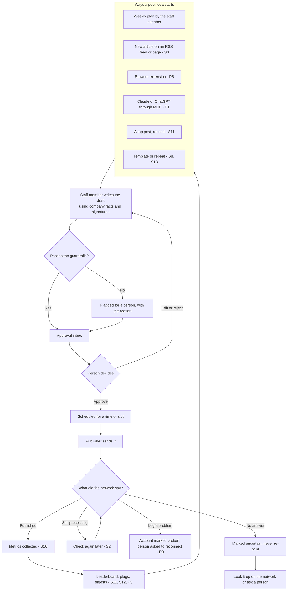

## What we already have

So we do not rebuild it:

- The approval inbox and the rule that only approved text is published.
- Guardrails: company facts only, banned terms, allowed links, hashtag and emoji rules, length limits per network.
- Publishing to Facebook, Instagram and X, with retry and back-off, and the "uncertain" handling.
- A first comment under a post (Postiz also has this).
- Replies to comments, held for a person, with the 24-hour direct-message window rule.
- Per-post metrics, a calendar, and connecting and disconnecting accounts.

---

## Group 1: Publishing in more places, more reliably

### S1. More networks that need no long approval

Add Bluesky, Mastodon, Telegram, Discord, Nostr and Lemmy as places the staff member can post.

These networks let you connect with a simple token or app password. Meta, LinkedIn and X can take weeks to approve our
app. The new ones let us publish for real, and run demos, in the meantime.

#### The story

Amara runs a small design studio. She wants her staff member to post to Bluesky and her Telegram channel too. She does not
want to wait weeks for Meta and LinkedIn. She wants to see real posts going out this week.

#### How it works

1. Amara opens **Accounts** and picks Bluesky.
2. She pastes an app password. She creates it herself in Bluesky's settings, so her real password is never shared.
3. We store the password encrypted, then test it by reading her profile.
4. The account shows as healthy.
5. From the next weekly plan, the staff member includes this network and writes drafts that fit its rules.
6. After approval, the publisher posts through the new provider.

#### Flowchart

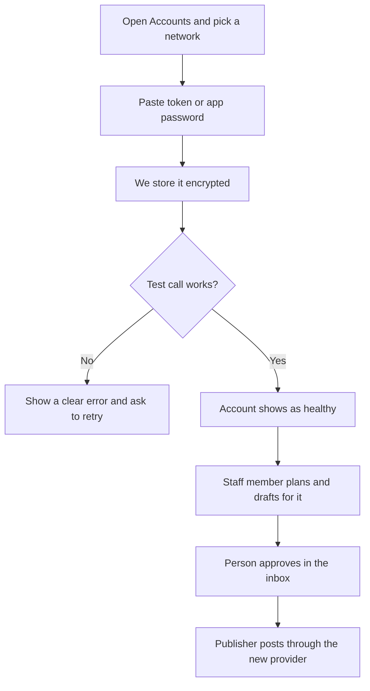

#### Good to know

- Effort: small to medium for each network. Each one is a new provider. The rest of the platform does not change.
- Telegram and Discord post into channels or servers, not personal feeds. Mastodon needs the address of the person's server.
- Check each network's current sign-in method before building. We have not done that yet.

### S2. "Accepted, still processing" publishing

Let a network say "I got it, I am still working on it", and check back later instead of giving up.

Videos and Instagram Reels take minutes to process. Today we wait about one minute and then stop. With this change, we keep
a ticket and check on it, for up to about 30 minutes.

#### The story

Tunde posts a Reel. After one minute he sees "Failed" and posts it again by hand. Then two copies appear. He wants the
page to say "Processing" and then "Published", so he knows not to touch it.

#### How it works

1. The publisher sends the post to the network.
2. The network answers with a ticket number, meaning "accepted, processing".
3. We save the ticket. The post shows **Processing**.
4. The worker checks the ticket every few seconds at first, then less often.
5. When the network says it is ready, we finish the publish step and save the link. The post shows **Published**.
6. If the network says it failed, the post shows **Failed** with the reason.
7. If 30 minutes pass with no answer, the post becomes **Uncertain**. A person checks and decides. We never resend by ourselves.

#### Flowchart

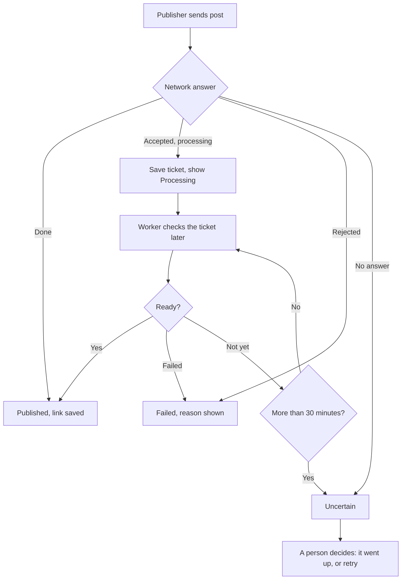

#### Good to know

- Effort: medium. Add "pending" and "check" steps to the provider contract.
- Postiz works this way. Postiz-cheap does too: it gets a request id, then polls a result address.
- It fits our main safety rule: an unknown result is never sent twice.

### S9. Missed-post recovery

An hourly check finds approved posts whose time has passed but that were never sent.

This happens when the worker was down or a queue was lost. Our current "reconcile" step only handles posts we know are
uncertain. This catches the ones nobody noticed.

#### The story

Maria's server restarted at 8:58. Her 9:00 post never went out, and nobody noticed until the afternoon. She wants the
system to notice within the hour and tell her, or fix it.

#### How it works

1. Every hour, a job looks for approved posts that are overdue and still waiting.
2. For each one, it checks the record: did sending ever start?
3. If sending never started and it is only a little late, it goes out now. The default window is a proposal: up to 3 hours.
4. If it is later than the window, a person is asked first. A post about "today's sale" may be wrong tomorrow.
5. If sending had started but the result is unknown, it follows the uncertain path.
6. Either way, the person gets a notification saying what happened.

#### Flowchart

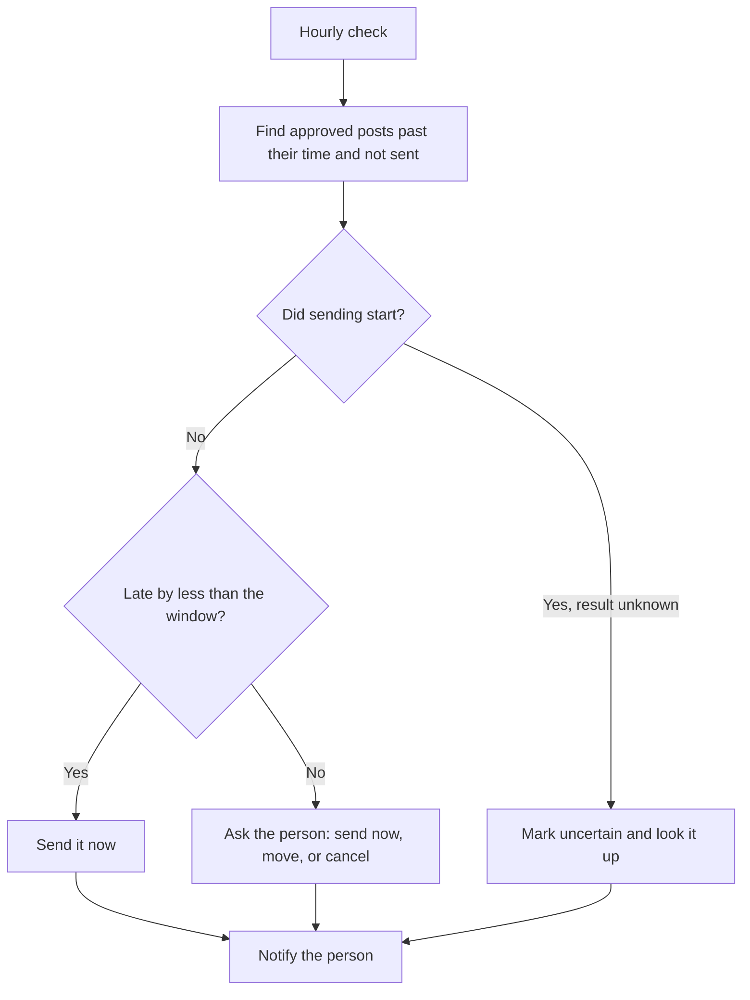

#### Good to know

- Effort: small. The late window should be a setting. Please confirm the 3-hour default.

### S4. LinkedIn

Post to a LinkedIn personal profile or company page, with pictures and video.

#### The story

Segun is a B2B founder. His customers are on LinkedIn, not Instagram. He wants his staff member to draft LinkedIn posts for
the company page and send them after he approves.

#### How it works

1. Segun clicks **Connect LinkedIn** and signs in on LinkedIn's own page.
2. He chooses his profile or a company page he manages.
3. The staff member drafts text, with a picture or video if it fits.
4. After approval, the publisher uploads the media in steps: register the upload, send the file, finish the upload.
5. It then creates the post that uses that media, and saves the link.

#### Flowchart

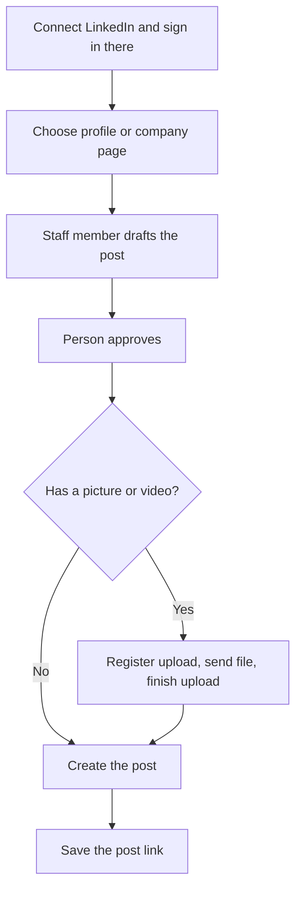

#### Good to know

- Effort: medium to large. Company pages need LinkedIn's approval (already in Milestone 0).
- Postiz uses versioned `/rest/` endpoints and a special protocol header. We will re-check LinkedIn's current docs before building.

### S5. Pictures and video on X

Today our X provider refuses media. This lets it send pictures and short videos.

#### The story

Ngozi's best posts have an image. Her staff member's drafts for X are text only, so she edits them by hand. She wants the
picture to go with the post.

#### How it works

1. A draft for X has an attached image or video.
2. We check the limits: up to 4 images, or 1 video, per post.
3. The file is uploaded in small pieces, then we wait until X finishes processing it.
4. The post is created with the media attached.
5. If X rejects the file (wrong size or type), the person sees a plain message saying why.

#### Flowchart

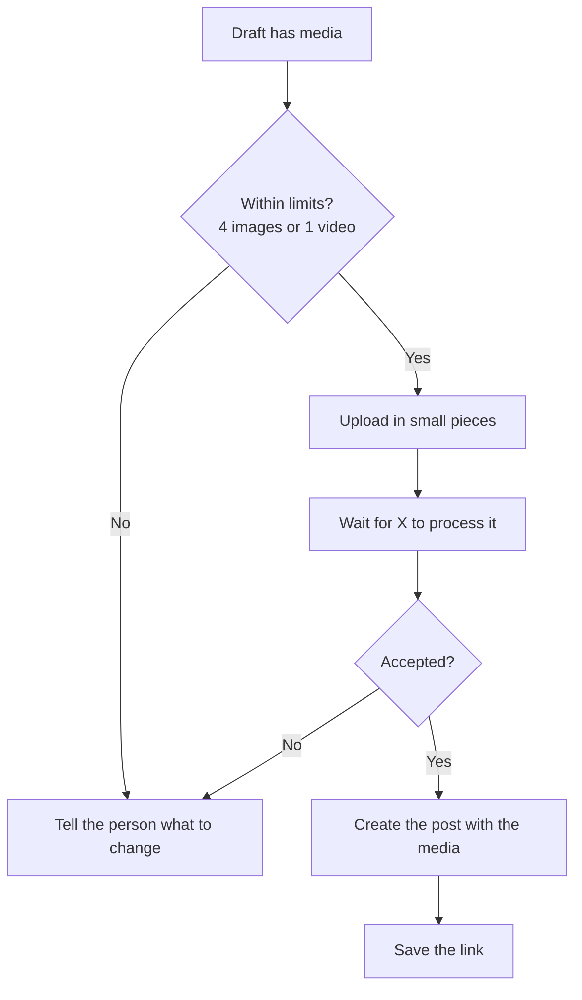

#### Good to know

- Effort: medium. Limits and endpoints must be re-checked against X's current docs.

### S6. Reply chains (threads)

One idea made of several connected posts, where each is a reply to the one before.

#### The story

Kola wants to explain "five mistakes new founders make" as a thread of five posts. Today each post stands alone. He wants
the inbox to show the thread as one item with five parts he can edit.

#### How it works

1. The staff member drafts a chain: post 1, post 2, post 3 and so on.
2. The inbox shows one item with each part editable and a length check on each.
3. Kola approves the whole chain once.
4. The publisher sends post 1 and waits for the network to return its id.
5. It sends post 2 as a reply to post 1, and so on.
6. If one part fails, it stops. The remaining parts are marked **Not sent** and Kola is told.
7. If one part is uncertain, it also stops. We never guess and carry on.

#### Flowchart

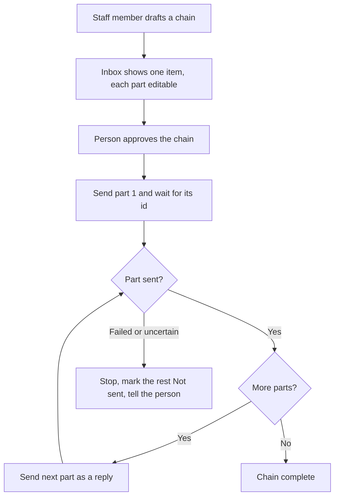

#### Good to know

- Effort: medium. A post needs ordered child parts. The stop-on-doubt rule matters most.

---

## Group 2: Planning content faster

### S3. Posts from an RSS feed or a web page

Watch a blog feed. When a new article appears, the staff member drafts a post about it.

#### The story

Bola publishes a blog article every week. She forgets to promote them. She wants a draft waiting in her inbox each time a
new article goes live, ready to approve.

#### How it works

1. Bola adds her feed address and picks options: draft only or schedule, include the article's picture, which accounts, tone.
2. A worker checks the feed every hour.
3. For a new article, it remembers the article's id so it is never handled twice.
4. The staff member reads only the title and summary, and writes a post using the company facts. The article link is added.
5. The draft goes to the inbox for approval.

#### Flowchart

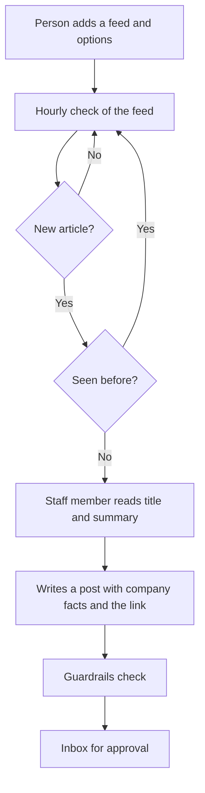

#### Good to know

- Effort: medium.
- Article text is treated as untrusted. It is material to summarise and can never give the staff member instructions.

### S7. Signatures

A saved sign-off added to posts automatically.

#### The story

Chidi ends every post with "- Team Bright | book a call at bright.example". He is tired of retyping it, and it sometimes
pushes his X posts over the length limit.

#### How it works

1. Chidi creates a signature and chooses which accounts use it. He can make it a default.
2. When a draft is built, the signature is added to the end.
3. The length check counts the signature, so nothing is cut off at the network.
4. The inbox shows the final text, signature included. What he approves is what is sent.

#### Flowchart

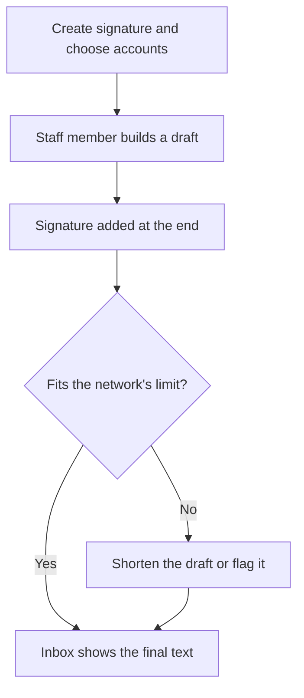

#### Good to know

- Effort: small. Store it as a company fact so the guardrails see it too.

### S8. Post templates (sets) and colour tags

Templates are saved post shapes. Tags are coloured labels you can filter by.

#### The story

Every Tuesday, Folake posts "Tip Tuesday". She wants to start from a saved shape, and see only her "Tip" posts on the
calendar.

#### How it works

1. Folake saves a template, for example "Tip: [one tip] - [why it helps]".
2. When planning, the staff member fills the blanks using company facts.
3. The draft gets the tag she set, "Tip", shown as a colour on the calendar.
4. She filters the calendar by tag.

#### Flowchart

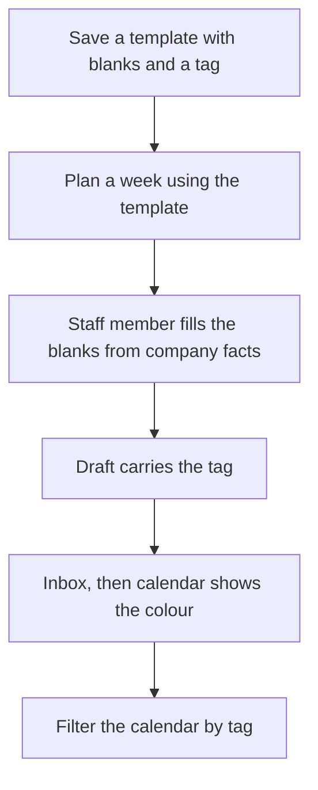

#### Good to know

- Effort: small. Mostly screens.

### S13. Preferred time slots and repeating posts

Slots are the times you like to post. Repeats re-publish evergreen content on a schedule.

#### The story

Ade knows her audience reads on Tuesdays and Thursdays at 9:00 and 17:00. She also has a "book a free call" post she wants
to re-run every month.

#### How it works

1. Ade sets slots for each account.
2. When a post is approved without a time, it takes the next free slot.
3. For a repeat she picks an interval (weekly, monthly), an end date and a maximum count.
4. She approves the series once. It runs until the end date or count.
5. If a company fact the text depends on changes, the series pauses and she is asked to look again. This is a proposed rule.
6. She can pause or stop the series at any time.

#### Flowchart

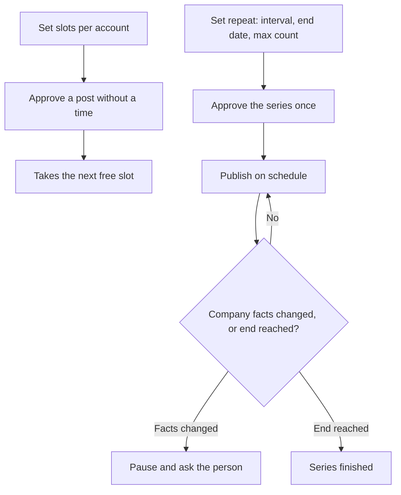

#### Good to know

- Effort: medium. Postiz-cheap only lists this on its roadmap and has not built it. Our weekly plan already picks times, so this is not urgent.

### S14. Drag-and-drop on the calendar

Move a post to a new day or hour by dragging its card.

#### The story

A client calls and says "move Friday's post to Monday". Ife wants to drag it, not open it and retype the date.

#### How it works

1. Ife drags the card to a new slot.
2. The screen updates at once.
3. The server checks that the post has not started sending, and that nobody else changed it meanwhile.
4. If all is well, the new time is saved. The approved text is unchanged, so it stays approved.
5. If not, the card snaps back and a short message says why.

#### Flowchart

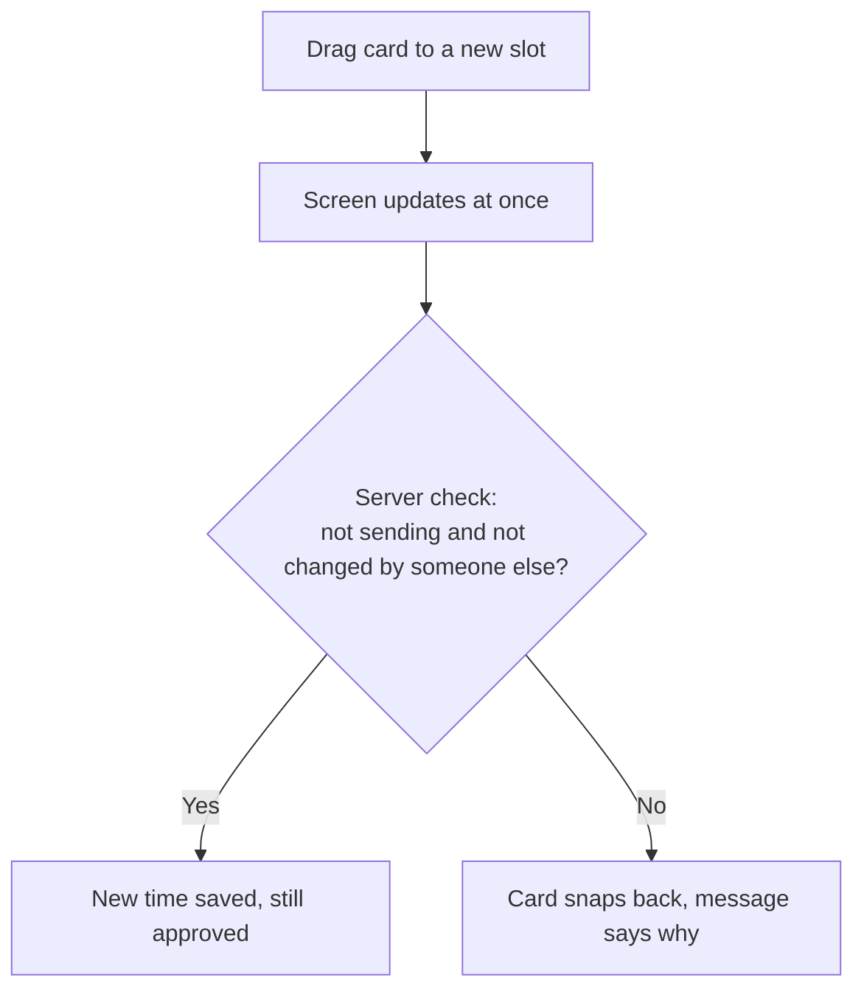

#### Good to know

- Effort: small. Moving a post into the past is not allowed.

### S15. Media library with crop presets

One place to keep pictures and videos, with ready-made crop shapes.

#### The story

Instagram posts need a picture, and today our staff member escalates them to a person because there is nothing to choose
from. Remi wants to upload her brand photos once and let the staff member pick from them.

#### How it works

1. Remi drags several files in. A progress bar shows each one.
2. We check file type and size, and save them in folders with tags and alt text for accessibility.
3. She crops with presets: square (1:1), story or reel (9:16), landscape (16:9), and common portrait (4:5). Confirm the exact sizes per network.
4. We keep the original and the crops.
5. When planning an Instagram post, the staff member picks from the library by tag. Remi can swap the picture in the inbox.

#### Flowchart

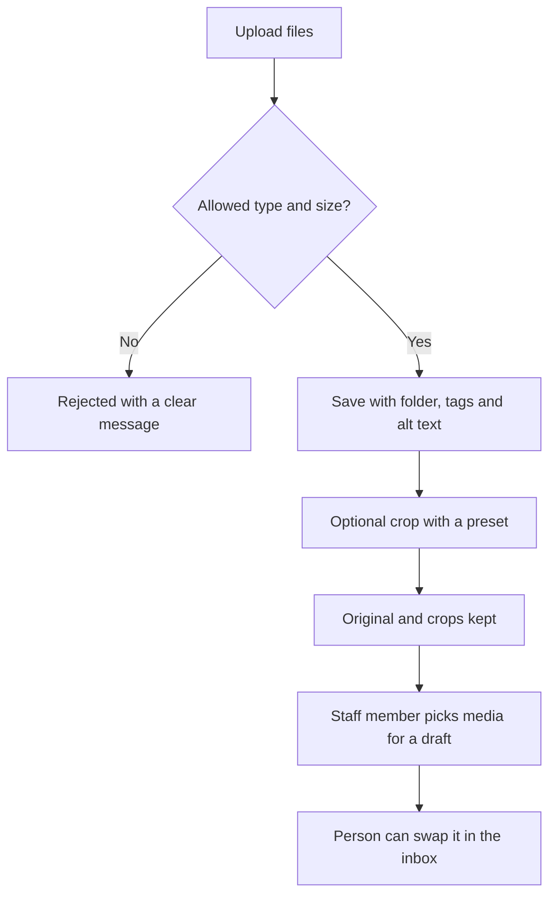

#### Good to know

- Effort: medium to large. It unblocks auto-planned Instagram posts, which are escalated today.

### S17. Safe @mentions (new idea)

When a draft tags a person or brand, look up the real account instead of guessing the name.

We already block unknown mentions. This makes tagging possible, safely. Postiz keeps a cached list of mention lookups.

#### The story

Hassan wants his post to thank a partner by tagging them. A wrong tag would tag a stranger. He wants the staff member to find
the right account, or ask him.

#### How it works

1. The draft contains "@name".
2. We look in the saved mention list for that network.
3. Found: use it.
4. Not found: search the network if it allows it, and show the matches to the person.
5. The person picks one. We save it for next time.

#### Flowchart

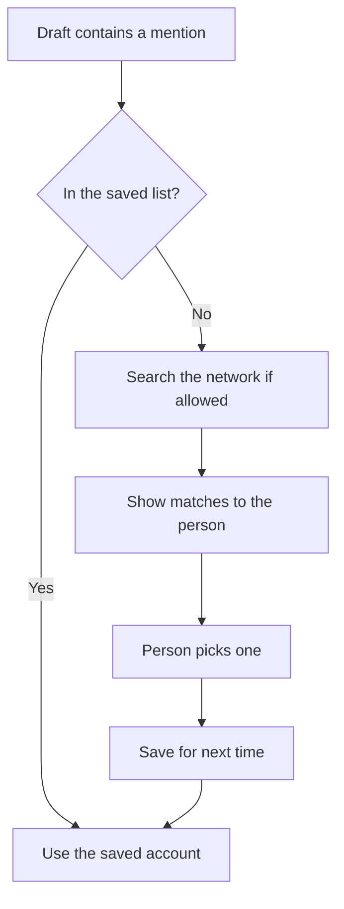

#### Good to know

- Effort: small to medium. Not every network lets you search for accounts.

---

## Group 3: Learning from results

### S10. Account-level analytics

Track the account, not only single posts: followers, reach and change over time.

#### The story

Yemi asks "is my audience growing?" Today she can only see likes per post. She wants a chart of followers by day and the change
since last month.

#### How it works

1. Every night a job asks each connected account for its numbers.
2. We store one row per account per day.
3. The dashboard shows charts for 7, 30 or 90 days, with the percentage change against the period before.
4. The staff member reads a short summary before it writes next week's plan.

#### Flowchart

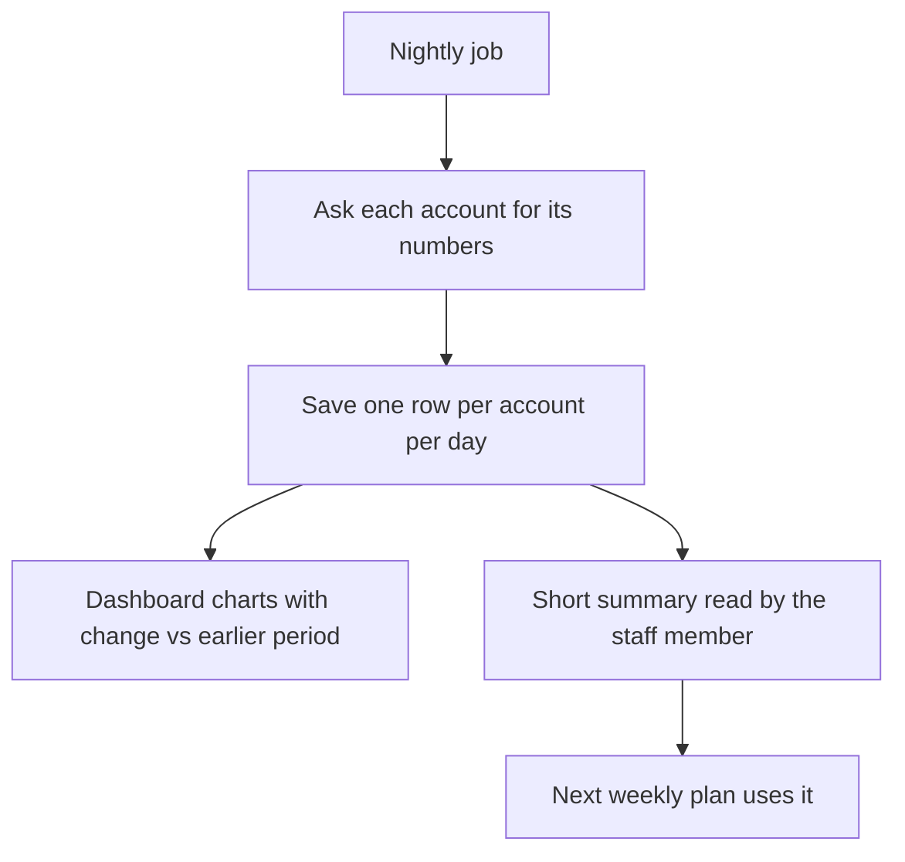

#### Good to know

- Effort: medium. KudiBooks already had a daily follower capture that can be ported.

### S11. Top-posts leaderboard and "reuse with AI"

A ranked list of the best posts, with a button to turn one into a fresh draft.

#### The story

Dami sees that her "3 pricing mistakes" post did best. She wants to try the same idea on LinkedIn with a new angle.

#### How it works

1. A table ranks posts by likes, comments, reach or engagement rate.
2. Dami clicks **Reuse** on the best post.
3. The staff member writes a new draft on a different angle or for a different network. It does not copy the old text.
4. The draft goes through the normal guardrails and the inbox.

#### Flowchart

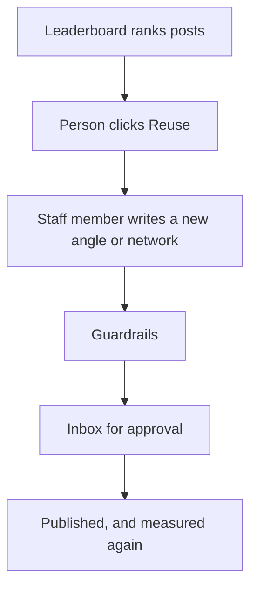

#### Good to know

- Effort: small after S10. Numbers arrive late and differ by network, so avoid comparing networks head to head.

### S12. Plugs: automatic follow-ups on our own posts

A rule such as "if a post gets 50 likes in a day, share it again next week".

#### The story

Lanre's launch post did far better than usual. He wants it to get a second push without remembering to do it.

#### How it works

1. Lanre creates a rule: the condition (50 likes), the action (draft a repost or a follow-up comment), and a maximum number of runs (3).
2. A job checks the metrics on a schedule.
3. When the condition is met and the run cap is not reached, the staff member makes a **draft**.
4. The draft waits in the inbox. In Postiz this happens automatically. In ours it still needs approval.
5. The rule stops after its cap.

#### Flowchart

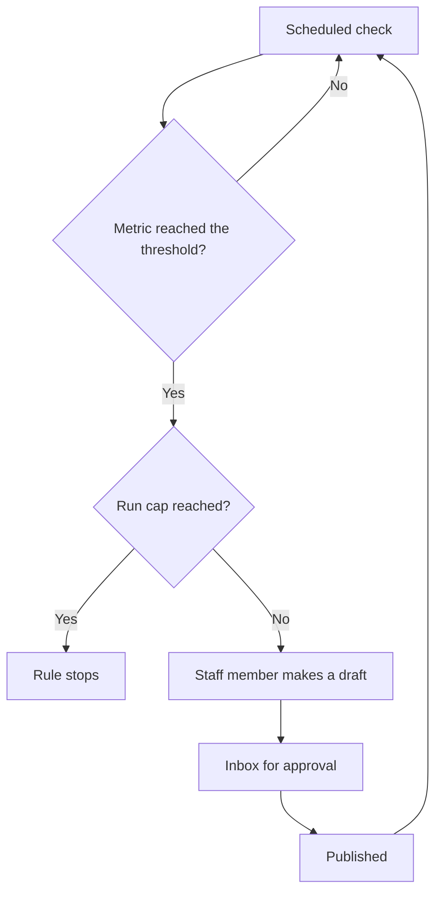

#### Good to know

- Effort: medium. Default off. Needs reliable metrics (S10) first.

---

## Group 4: Platform and integrations

### P1. MCP server and public API

Let Claude, ChatGPT and other tools use our staff members' tools, still behind approval.

MCP is a standard way for an AI app to use another app's tools. Postiz offers this for scheduling.

#### The story

Dayo already talks to Claude all day. He wants to say "schedule this for Thursday" and have it show up in his inbox as a draft.

#### How it works

1. Dayo connects Claude to our platform, using sign-in or an API key with limited permissions.
2. Claude can list accounts, read the inbox, upload media from a link, and create a draft.
3. Claude cannot publish. A draft always lands in the inbox.
4. Dayo approves it in the web app.

#### Flowchart

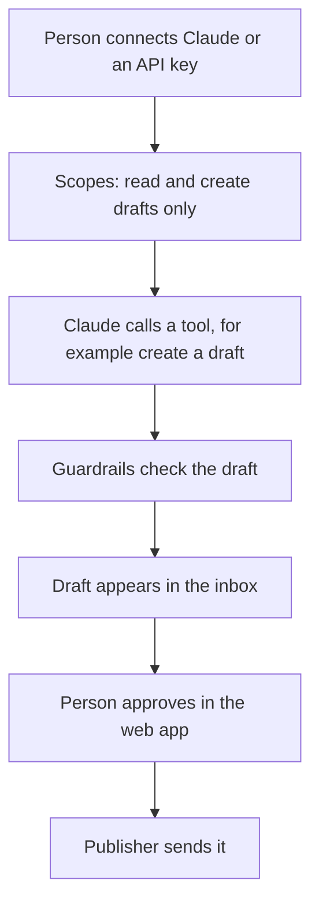

#### Good to know

- Effort: large. Needs scoped keys shown once, revocation, and rate limits. It is a differentiator, because the safety rules stay in place.

### P2. Media and link helpers

Pluggable storage, "upload from a link", and short links with click counts.

#### The story

Tolu wants her links shortened, and wants to see who clicked.

#### How it works

1. A draft contains a link from the allowed list.
2. A short-link provider turns it into a short one, on a branded domain if set.
3. The post publishes with the short link.
4. A daily job fetches the clicks and shows them next to the post's metrics.

#### Flowchart

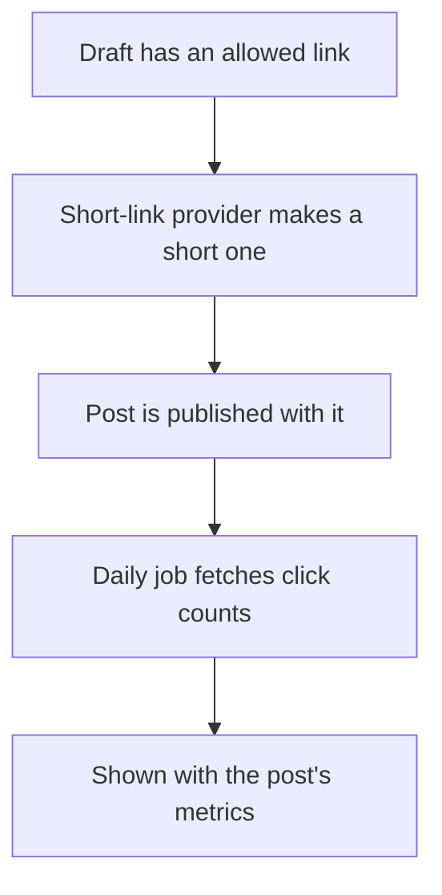

#### Good to know

- Effort: medium. Postiz supports Dub, Kutt, Short.io and LinkDrip. The same adapter pattern will suit the video vendors in M4b.

### P3. Outbound webhooks

We call a web address the customer chooses when something happens.

#### The story

Kemi's team wants a Slack message when a post goes live, through a tool like Zapier.

#### How it works

1. Kemi adds a web address and picks events: published, failed, reply received.
2. When one happens we send a small JSON message, signed so the receiver can check it is us.
3. If the receiver fails, we retry with longer waits.
4. After many failures we pause it and tell Kemi.

#### Flowchart

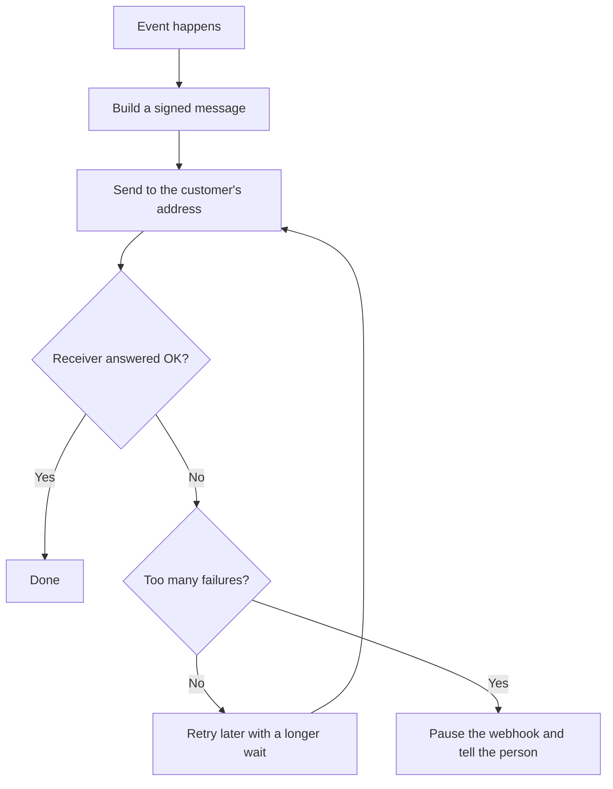

#### Good to know

- Effort: small to medium. Use our existing signing code.

### P4. Readable failure log

When a post fails, record why, in words a person understands.

#### The story

A post failed. Support asks "what happened?" Today someone has to read server logs. Joy wants to open the post and see it.

#### How it works

1. A publish fails.
2. We sort the cause: login problem, rate limit, bad media, or other.
3. We remove tokens and personal data from what we store.
4. The post page shows a plain explanation and what to do next.

#### Flowchart

```mermaid
flowchart TD
  A["Publish fails"] --> B["Sort the cause"]
  B --> C["Remove tokens and personal data"]
  C --> D["Save the entry"]
  D --> E["Post page shows a plain explanation"]
  B -- "Login problem" --> F["Account health flow - P9"]
```

#### Good to know

- Effort: small. Redaction is the important part.

### P5. Notifications and weekly digest

A bell in the app and a short weekly email.

#### The story

Wale does not open the app every day. He wants a Monday email: "3 posts went out, 2 are waiting for you, your best post was X".

#### How it works

1. Events create notifications, for example "2 drafts waiting".
2. The bell in the app shows them.
3. On Monday a job builds a digest for people who opted in.
4. The email has an unsubscribe link.

#### Flowchart

```mermaid
flowchart TD
  A["Events: drafts waiting, post failed, post published"] --> B["Save a notification"]
  B --> C["Bell in the app"]
  D["Monday job"] --> E{"Person opted in?"}
  E -- "Yes" --> F["Build and send the digest with an unsubscribe link"]
  E -- "No" --> G["Skip"]
```

#### Good to know

- Effort: small to medium, after billing and onboarding (M5). Postiz also has streak badges. We do not recommend copying them.

### P6. Agency mode

One person looks after several client brands, with roles.

#### The story

Ife runs an agency with five clients. Each client's manager should only see their own brand and approve its posts.

#### How it works

1. Ife creates a workspace for each client.
2. She invites people with a role: Admin, Editor or Approver.
3. A switcher in the sidebar changes the active client.
4. An Editor drafts and submits. An Approver approves. Nothing is sent before that.

#### Flowchart

```mermaid
flowchart TD
  A["Create a workspace per client"] --> B["Invite people with a role"]
  B --> C["Switch client in the sidebar"]
  C --> D["Editor drafts and submits for review"]
  D --> E{"Approver decides"}
  E -- "Approve" --> F["Scheduled and published"]
  E -- "Reject" --> G["Back to the editor with a note"]
```

#### Good to know

- Effort: large. We already isolate each workspace. The main question is letting one login reach several workspaces.

### P8. Browser extension (new idea)

Send something you are reading to your staff member with one click.

#### The story

Seyi reads an article and finds a great sentence. He highlights it, clicks the extension, and later finds a draft post
about it, with the source link.

#### How it works

1. Seyi installs the extension and signs in with a limited key that can only create ideas.
2. He highlights text and clicks **Send to my staff**.
3. We save the page address and the selected text as an idea. The text is untrusted material.
4. The staff member drafts a post that credits the source.
5. It goes to the inbox as usual.

#### Flowchart

```mermaid
flowchart TD
  A["Highlight text and click the extension"] --> B["Send page address and text with a limited key"]
  B --> C["Saved as an idea, treated as untrusted"]
  C --> D["Staff member drafts a post with the source link"]
  D --> E["Guardrails"]
  E --> F["Inbox for approval"]
```

#### Good to know

- Effort: medium. Postiz has an extension. Best built after the API (P1), since it uses it.

### P9. Account health and early reconnect warnings (new idea)

Warn before a connection expires, and make reconnecting easy.

Today an account only turns "broken" after a post fails. Postiz refreshes tokens ahead of time.

#### The story

Nia's Instagram connection expired over the weekend. Her Monday post did not go out. She wants a warning before it happens.

#### How it works

1. A daily job checks each account's token expiry.
2. If the network allows it, we refresh the token quietly.
3. If it cannot be refreshed and expires in 7 days, we notify the person and show **Expires soon**.
4. One click on **Reconnect** takes her through sign-in.
5. If it breaks anyway, posts pause. They resume after she reconnects, and she is told which posts waited.

#### Flowchart

```mermaid
flowchart TD
  A["Daily check of token expiry"] --> B{"Can we refresh quietly?"}
  B -- "Yes" --> C["Refreshed, stays healthy"]
  B -- "No" --> D{"Expires within 7 days?"}
  D -- "No" --> A
  D -- "Yes" --> E["Show Expires soon and notify"]
  E --> F["Person clicks Reconnect"]
  F --> G["Healthy again, waiting posts resume"]
  E -- "Ignored and it expires" --> H["Account broken, posts paused"]
  H --> F
```

#### Good to know

- Effort: small to medium. Builds on our existing "broken" state.

### P7. Using a paid aggregator for hard networks (not planned)

One paid service that publishes to TikTok, YouTube, Pinterest and others for us. This is what Postiz-cheap does with MuAPI.

#### The story

A founder says "I need TikTok next week". Going through TikTok's own approval takes longer than that. An aggregator could cover it.

#### How it would work

1. Our publisher calls the aggregator instead of the network.
2. The aggregator holds the user's connection and posts for us.
3. We poll for the result, as in S2.

#### Flowchart

```mermaid
flowchart TD
  A["Our publisher"] --> B["Aggregator's API"]
  B --> C["The network"]
  C --> D["Result"]
  D --> B
  B --> E["We poll for the result"]
  E --> F["Published or failed"]
```

#### Good to know

- The price: the vendor holds our users' tokens, we depend on it, it charges per use, and its terms bind us.
- This is a business decision for Milestone 0. It is not planned.

---

## Ideas we advise against

- **Temporal workflow engine (Postiz).** Powerful but heavy. Our Postgres plus BullMQ design with idempotent jobs does the same job more simply.
- **Autonomous AI scheduling (Postiz).** It publishes without asking. Our approval-first design is the product's advantage.
- **Bold and italic text using special Unicode letters (Postiz-cheap roadmap).** Screen readers read them badly and search can miss them.
- **Any code from Postiz** (AGPL) **or from Postiz-cheap** (security problems: anyone can log in as anyone, a fixed fallback session secret, an open download proxy, and posts published inside a page request).
- **The `postiz-leaked` repo.** Not reviewed, for legal and malware reasons.

## Suggested build order

1. **S1 more networks.** Quick, no approvals needed, gives real demos.
2. **S2 pending publish.** Needed for video and Reels to behave.
3. **S9 missed-post recovery and P9 account health.** Reliability.
4. **S3 RSS posts, S7 signatures, S17 safe mentions.** Quick wins for planning.
5. **S15 media library.** Unblocks Instagram.
6. **S4 LinkedIn and S5 X media.** When the approvals in Milestone 0 land.
7. **S10 analytics, then S11 leaderboard and S12 plugs.** Plugs need reliable numbers first.
8. **P1 MCP and API, then P3 webhooks and P8 extension.** The extension and webhooks build on the API.
9. **S6 threads, S13 slots and repeats, S14 drag-and-drop, S8 templates.** Nice to have.
10. **P4 failure log, P5 digest, P6 agency mode.** After onboarding and billing (M5).
