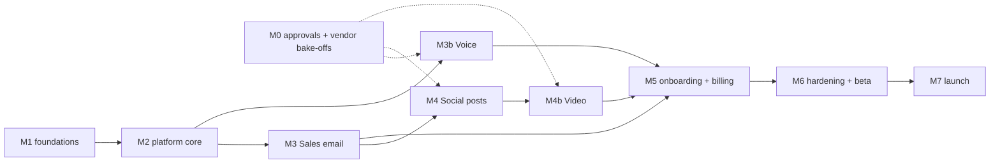

# Implementation plan

Status: draft v1, 2026-10-29. Milestones are ordered by dependency. Each one ends in something you can run and demo.
Sizes are relative (S/M/L); they are not commitments.

## Milestone 0: external approvals and accounts (start now, runs in parallel)

These have the longest lead times and none of them need code:

- [ ] Meta developer app; submit for app review with screencasts once M4 has a working flow (start business verification now).
- [ ] LinkedIn developer app; apply for Community Management API access.
- [ ] X API: choose the paid tier that allows posting at our volume.
- [ ] Paystack: business account; confirm **USD** charging and international cards; get test and live keys.
- [ ] Anthropic API account and organisation spend limits; record current data-use terms.
- [ ] Domain, transactional email provider, and status page.
- [ ] A lawyer to review terms, privacy, DPA, AUP and email-law positions (SECURITY-AND-COMPLIANCE.md).
- [ ] A product name and brand (see DECISIONS.md).
- [ ] **Voice vendor bake-off (2 weeks):** telephony (Twilio / Telnyx / Vonage), streaming STT, and streaming TTS. Build a
      throwaway prototype call loop in our region. Measure p50 and p95 response latency, per-minute cost, number coverage
      and regulatory API for US, CA and UK, and data terms. Pick one of each.
- [ ] Open the telephony account; start business verification and regulatory bundles for US, CA and UK numbers; enable
      STIR/SHAKEN.
- [ ] **Video vendor bake-off (2 weeks):** template renderer (rendering API vs self-hosted Remotion/FFmpeg; check Remotion's
      company licence), presenter/avatar API, generative video API, licensed stock and music APIs. Render the same 3
      scripts in each. Measure cost, quality, render time and API terms, including commercial use and AI-labelling metadata.
- [ ] TikTok Content Posting API application; Google OAuth verification for YouTube upload.
- [ ] Find out which trend data the networks and APIs give us legally (`TrendSource` candidates).
- [ ] Legal: AI calling (TCPA, recording consent, disclosure), likeness and voice consent form, video content policy.

## Milestone 1: foundations (L)

Goal: a multi-tenant skeleton you can sign up to.

- Monorepo (pnpm + Turborepo), with `apps/api`, `apps/worker`, `apps/web`, and `packages/{config,db,contracts,core,llm,connectors,billing}`.
- Typed config, logging with redaction, error model, OpenTelemetry, Sentry.
- Postgres migrations, the tenant-scoped repository helper and RLS; Redis; BullMQ wiring with a fake job.
- Auth: sign-up, verification, login, refresh rotation, reset password, MFA. Workspaces, members, invitations.
- Web: auth pages, workspace switcher, empty dashboard, settings.
- CI: lint, type-check, unit and integration tests (Postgres + Redis in Docker), build images.

Exit: two users in two workspaces cannot see each other's data (automated test); CI is green; deployed to staging.

## Milestone 2: platform core (L)

Goal: the machinery every role uses, proven with a dummy role.

- `RoleDefinition` / `TaskDefinition` types, the role registry, and a `dummy` role used only in tests.
- Task engine: schedules, event subscriptions, person triggers, leases, `Defer`/`Cancel`, back-off, dead jobs with alerts.
- `ModelProvider` port, Anthropic adapter, fake adapter, and a pricing table.
- Budget reservations with reserve, settle and release, plus spend caps. **Port** `SalesAgentService.reserve/settle/release` and generalise them to workspace and staff.
- Guardrail library: port `linksAllowed` and the opt-out append; add `factsOnly`, `bannedTerms` and `lengthFor`.
- Effects executor, work items, the approval inbox API and UI, the activity log and the audit log.
- Autonomy settings, promotion evaluator (nightly) and auto-demotion hooks.
- Company brain: profile and facts CRUD, versioning, and `company.facts_changed` invalidation.
- Website prefill job (port `safe-fetch.ts` plus `summarisePage`; add multi-page crawl on the same host).

Exit: the dummy role runs on a schedule, reserves budget, calls the fake model, lands a work item in the inbox,
and approval creates an effect. Killing the worker mid-run recovers correctly (test).

## Milestone 3: Sales Manager Staff (L)

Ported first because KudiBooks' version is the most complete and was proven in production with Jackson.

- SMTP/IMAP connector (MailSender, MailReader), DNS checks (SPF/DKIM/DMARC), test send, warm-up limits.
- Inbound: forwarding endpoint, IMAP polling worker, threading (port the `email-thread` helpers).
- Leads: CSV import with preview, manual entry, research task (port the worker `research`).
- Tasks: `first_touch`, `follow_up` and `triage_reply` (port the prompts, tool schemas and clamping from `SalesAgentModelService`),
  `weekly_report`.
- Send intents and the dispatcher (port `SalesAgentMailService.createOutgoing/dispatch/receive`, including uncertain handling).
- Suppressions (workspace + global), `List-Unsubscribe` headers, one-click unsubscribe endpoint.
- Policy checks (port `SalesAgentPolicyService.checkSend`): hours, daily limits, warm-up, suppression.
- Pipeline UI: leads, conversations, take over, give back. Hire flow and interview for the role.
- Eval set: 30 outreach fixtures and 40 reply fixtures (every classification, plus prompt-injection cases).

Exit: a test workspace sends real approved emails from a real mailbox; a reply is triaged; an opt-out suppresses;
nothing sends outside hours or over limits (tests).

## Milestone 3b: Voice line for Sales Manager Staff (L)

Can start in parallel with M3 once M2 is done, if a second engineer is available. It depends on M0's voice vendor choice.

- `packages/voice`: `TelephonyProvider`, `SpeechToText` and `TextToSpeech` adapters; turn loop with VAD, end-of-turn
  detection and barge-in; realtime tools; per-turn guardrails.
- `apps/voice` gateway: media stream WebSocket, call sessions, call context loader, block budget reservations,
  graceful drain on deploy.
- Numbers: search, provision, the regulatory bundle flow, the forwarded-number verification call, release after 30 days.
- Inbound: the incoming-call webhook, hours, greeting with disclosure and recording notice, and the outcomes (book, message, transfer, end).
- Handoff: warm transfer with whisper, sequential or simultaneous ringing, no-answer fallback; browser live listen
  (SSE transcript) and take-over (WebRTC).
- After the call: the `call_summary` task, lead creation and update, recording storage with expiry, metering.
- Outbound: consent records (web form snippet, inbound callback request, email "call me"), DNC lists, calling
  windows by recipient timezone, attempt limits, the `call_lead` task with approval, the call list UI.
- Simulated-caller harness and nightly latency test (VOICE.md §9).

Exit: a real call to a test number is answered in under 1.6 s p95 response latency. Pricing beyond the offers
transfers to a phone and the whisper is heard. No answer leads to a message and a callback task. An outbound call is refused without consent
and placed with it (tests and a manual run).

## Milestone 4: Social Media Staff (L)

- Connectors: Meta (Facebook Pages + Instagram), LinkedIn Pages and X (port `social/providers/*`; re-verify against current APIs).
- Media library with signed uploads, re-encoding and per-network media validation.
- Tasks: `plan_week`, `draft_post`, `suggest_captions` (port `SocialCaptionsService`), `triage_engagement`,
  `capture_metrics` and `weekly_report`.
- Publish intents and the dispatcher (port `social-publishing.scheduler.ts`), with network checks for uncertain outcomes.
- Webhooks for comments and messages; the reply-window logic (port from `social-messages.service.ts`).
- Social → sales handoff through `lead.created`.
- Calendar UI, composer, engagement inbox. Hire flow and interview for the role.
- Recorded walkthroughs for the Meta app review submission.

Exit: a test workspace plans, gets approval for, and publishes posts to every approved network; a comment with buying
intent creates a lead that the sales staff member picks up.

## Milestone 4b: Video for Social Media Staff (L)

Depends on M4 (publishing) and M0's video vendor choice.

- Brand kit (prefilled from the website) and a TTS voice picker.
- `TrendSource` adapters chosen in M0, plus the business's own metrics as a source.
- Tasks: `video_ideas`, `video_script` (schema, `factsOnly` over voiceover, on-screen text and captions) and storyboard
  resolution (own media → stock → generated).
- `packages/media`: renderer adapters (template, presenter, generative), voiceover, licensed stock and music, FFmpeg
  transcodes (9:16, 1:1, 16:9), captions (burned in and SRT), thumbnails, loudness normalisation, C2PA, asset manifests.
- The `media` worker pool, render webhooks and polling, credit reservations and settlement, retry and fallback to template.
- Review UI: a player per aspect ratio, a watch-to-end gate, the checklist, approve per network, request changes.
- Video publishing per network: resumable uploads, AI-content label flags, caption disclosure fallback.
- Likeness and voice consent records, and the rule blocking custom avatars or voices without one.
- An eval set of 30 scripts and nightly golden renders per mode.

Exit: from one product fact, the system produces ideas, a script and renders in all three modes. Approval is blocked until
the video is watched. The approved video publishes to Instagram, TikTok, YouTube Shorts, Facebook and X with AI labels set,
and failed renders are not charged.

## Milestone 5: onboarding and billing (M)

- The full onboarding flow (ONBOARDING.md), with analytics events.
- Plans, trial, seats and entitlements. Paystack initialize, `charge.success`, stored authorizations, the renewal job,
  upgrades, top-ups, `past_due` handling and invoices (BILLING.md).
- Spend cap UI and alerts. Usage dashboard.
- Platform admin: tenants, usage, suspend, kill switches, impersonation.

Exit: a new user goes from the landing page to a paid subscription in the Paystack test environment without help;
renewal and a failed-card path work in tests.

## Milestone 6: hardening and private beta (M)

- Security review of the **[review]** items; dependency and secret scanning; backup restore drill.
- Load test: 500 workspaces, 2 staff members each, a week of schedules compressed into an hour.
- Voice load test: 200 concurrent simulated calls with latency held within budget. Video: 100 concurrent renders.
- Legal sign-off on the AI calling scripts, disclosure wording, recording notice, consent capture and video policy.
- Weekly reports polished; email templates; help centre basics.
- Private beta with 10–20 hand-picked customers: free or discounted, with a weekly call. Measure the PRD metrics.
- Set the real prices from beta cost and value data.

Exit: PRD launch targets met or understood; Meta and LinkedIn approvals granted; legal docs signed off.

## Milestone 7: public launch (S)

Marketing site, pricing page, self-serve sign-up open, status page and on-call rota.

## Sequencing at a glance

Voice and video add two large milestones. With one engineer they run in sequence (M3 → M3b → M4 → M4b). With two, run
M3b alongside M3/M4 (the voice gateway is a separate service with few shared files).

## Port map from KudiBooks

| KudiBooks source | New home | Change needed |
|---|---|---|
| `sales-agent/sales-agent-model.service.ts` | `roles/sales-manager` tasks + `llm` adapter | Split prompts and schemas from the HTTP client; zod schemas |
| `sales-agent/sales-agent-worker.service.ts` | `core` task engine + sales tasks | Generalise the job claim and lease to BullMQ + `task_runs`; keep `Defer`/`Cancel` |
| `sales-agent/sales-agent.service.ts` (reserve/settle, suppression, readiness) | `core` budgets, sales suppressions, role readiness | Workspace and staff scope; remove KudiBooks module and plan checks |
| `sales-agent/sales-agent-mail.service.ts` | `connectors/smtp-imap` + `core` intents | Separate the transport from intents |
| `sales-agent/sales-agent-policy.service.ts` | sales role policies | Add warm-up and country rules |
| `sales-agent/safe-fetch.ts` (+ spec) | `core/fetch` | Keep the tests; add a crawl |
| `sales-agent/sales-agent-crypto.ts`, `social/token-crypto.ts` | `core/crypto` | One module with key IDs |
| `social/providers/*`, `PLATFORM_LIMITS` | `connectors/{meta,linkedin,x}` | Capability interfaces; add LinkedIn |
| `social/social-captions.service.ts` | `roles/social-media` | Prompt to definition; brain facts instead of `brandVoice` only |
| `social/social-publishing.scheduler.ts` | `core` publish dispatcher | Intents and uncertain handling |
| `social/social-messages.service.ts` | social `triage_engagement` + Meta connector | Reply-window rule as a guardrail |
| `deploy/jackson-inbound/worker.mjs` | `infra/inbound-email-worker` | Multi-tenant routing by address |
| (none) | `apps/voice`, `packages/voice`, `packages/media` | New. KudiBooks has no voice or video code |

Copy code, don't link it. KudiBooks keeps working unchanged. Licensing is fine because both are Pacifylabs-owned (confirm).

## Definition of done (every story)

Tests for new behaviour (including unhappy paths); tenancy test for new endpoints; no secrets or content in logs;
zod validation at boundaries; docs updated if behaviour or API changed; reviewed; deployed to staging.
