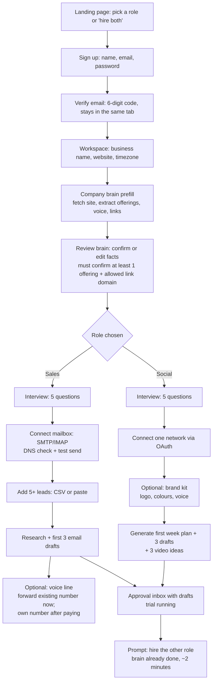

# Onboarding

Status: draft v1, 2026-10-29. Target: **median time from sign-up to first approved piece of work under 10 minutes.**

## Principles

- **Show work before asking for money.** The trial starts without a card. The card is asked for at trial end, or earlier to unlock acting on its own.
- **Prefill everything we can.** The owner should be correcting, not typing.
- **One required connector per role, at the moment it's needed.** Not a wall of connections up front.
- **The first screen after onboarding is the approval inbox with real drafts in it.**

## Flow

## Step details

| Step | Details | Failure path |
|---|---|---|
| Prefill | `safe-fetch` of the home page plus up to 4 linked pages (about, pricing, services, products), all on the same host. The model extracts facts into `company_facts` with `source = website`. Takes under 30 s, with progress shown. | Site unreachable → manual form with examples. |
| Brain review | Facts are grouped (what you sell, offers and prices, who you sell to, voice, links). Each can be kept, edited or deleted. Prices are shown as "unconfirmed" until the owner ticks them. | Nothing confirmed → can't continue (staff need ground truth). |
| Social connect | OAuth popup. On return, the owner picks which pages or accounts this staff member may use. | Missing permissions → explain which, retry. App still in review for a network → "coming soon" plus copy-and-post mode. |
| Mailbox connect | Host, port, user and app password. We test login, run SPF/DKIM/DMARC lookups, then send a test email to the owner. A wizard shows the exact DNS records to add if any are missing. | DNS missing → the staff member can still draft; sending is blocked until fixed. A daily re-check notifies the owner when it passes. |
| Leads | CSV upload with a column-mapping preview, or paste emails. Duplicates, suppressed addresses and invalid addresses are flagged before import. | Fewer than 5 leads → staff member still activates; drafts wait for leads. |
| Brand kit | Logo and colours are prefilled from the website (favicon, theme colours). The owner picks a voice from 6 samples. Can be skipped; defaults are used. | Skipped → neutral template and default voice. |
| Voice line | During the trial: show the platform number to forward to, then place a verification call ("press 1"). After paying: choose a country and area code, provision a number, and submit regulatory details where required. Set the greeting, hours and handoff phone. A test call is placed to the owner's phone. | Number awaiting regulatory approval → forwarding mode until it's approved. Verification call fails → instructions per carrier. |
| First drafts | Runs on a priority queue. Small model. Budget comes from the trial allowance. | Model unavailable → "drafts will appear shortly" plus an email when ready. |

## Trial

- 7 days, one of each role allowed, everything stays in `draft` (no promotion during the trial).
- Social: publishing approved posts is allowed, up to the trial allowance.
- Sales: sending approved emails is allowed, at 10 new contacts a day.
- Spend is capped by the trial allowance (see BILLING.md). Nothing is charged without a card.
- Day 5: an email with work done, approval rate, and a link to choose a plan.
- Day 7: unpaid staff are paused (not deleted). Drafts and data are kept for 30 days.

## Activation checklist (readiness)

A staff member can be activated when:
- the workspace is entitled (trial or paid seat);
- the company brain has at least one confirmed offering and one allowed link domain;
- the required connectors are healthy;
- the role's own readiness checks pass (for sales: DNS ok, test send delivered).

The UI shows unmet items as a checklist with a fix link for each (pattern from KudiBooks `SalesAgentService.readiness`).

## Measuring onboarding

Events (product analytics; no message content is recorded):
`signup_started`, `email_verified`, `workspace_created`, `brain_prefilled`, `brain_confirmed`, `role_selected`,
`connector_connected`, `first_draft_ready`, `first_approval`, `brand_kit_saved`, `first_video_approved`,
`voice_line_live`, `first_call_handled`, `second_role_hired`, `trial_converted`.

The funnel reviewed weekly is sign-up → first approval → paid.
