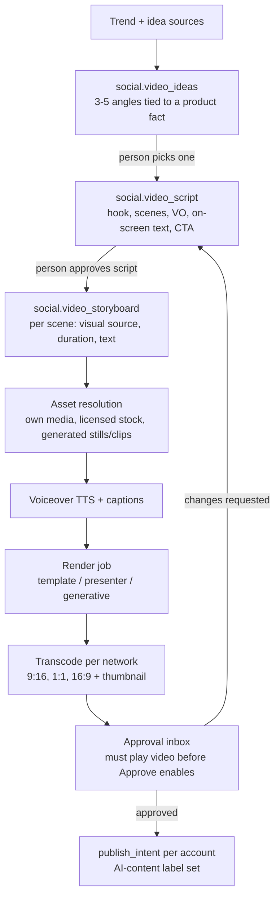

# Video pipeline (Social Media Staff)

Status: draft v1, 2026-10-29. In launch scope (decision D16).

Social Media Staff turn a trend or campaign idea into a short video about the business's own product or service:
idea → script → storyboard → render → **person approves the actual video** → publish with AI labels. Nothing
generated is ever published without a person watching it first.

## 1. Stages



There are two approval gates by default: script and final video. The owner can skip the script gate (in settings), but
**never the final video gate**. That gate is not promotable. Decision D16.

## 2. Trend and idea sources

Ideas are suggestions with their source shown. Reach and popularity are never stated as fact.

| Source | What it gives | Notes |
|---|---|---|
| The business's own published posts and metrics | Which topics and formats worked | Always available once posting starts |
| Company brain | Products, offers, campaigns, seasonal dates | Every idea must reference at least one product or offer fact |
| Network trend data available to us | Trending formats, hashtags, audio (where licensed for business use) | Access varies by network and API tier, so it is checked in M0 and each source is kept behind a `TrendSource` interface |
| Search interest | Rising queries in the niche | e.g. a search-trends provider; `TrendSource` |
| Owner input | "We launch X on Friday" | Campaigns |

`social.video_ideas` gives a working title, the trend or angle and its source, the product fact used, the format
(template, presenter, generative) and an estimated credit cost.

## 3. Script

Output schema (forced tool output):

```ts
{
  title: string;
  durationSec: 15 | 30 | 45 | 60;
  hook: string;                 // first 2 seconds
  scenes: Array<{
    seconds: number;
    voiceover: string;
    onScreenText?: string;      // ≤ 60 chars
    visual: { kind: 'own_media' | 'stock' | 'generated' | 'presenter'; description: string; mediaId?: string };
  }>;
  cta: string;
  captionsPerNetwork: Record<Network, { body: string; hashtags: string[] }>;
  claimsUsed: string[];         // fact ids — checked by factsOnly
}
```

Guardrails: `factsOnly` over the voiceover, on-screen text and captions; `bannedTerms`; `allowedLinks`; a duration sum
that matches `durationSec`; no named real people or competitor brands unless they are in the facts; music is never
named or requested by title.

## 4. Rendering modes

| Mode | What it is | When to use | Relative cost | Provider interface |
|---|---|---|---|---|
| **Template** | The business's own photos and clips plus licensed stock, with motion templates, captions, voiceover and music from a licensed library | Default. Product showcases, offers, tips | 1 credit | `TemplateRenderer` |
| **Presenter** | An AI presenter (stock avatar, or a custom avatar of a real person **with that person's signed consent**) speaking the script over brand visuals | Explainers, announcements | 3 credits | `PresenterRenderer` |
| **Generative** | Scenes generated from text or image prompts by a video-generation model, combined with real product shots | Mood and lifestyle shots, concepts | 10 credits | `GenerativeRenderer` |

Credit weights are placeholders, set from measured vendor cost in the beta. Candidates to evaluate in M0:
- **Template:** a rendering API (Shotstack, Creatomate) or self-hosted Remotion/FFmpeg. Check Remotion's company license terms.
- **Presenter:** HeyGen, Synthesia.
- **Generative:** current text-to-video APIs from major model providers and Runway.

All are chosen behind interfaces so they can be swapped.

**Product accuracy rule:** generated visuals may not *depict the product itself* unless the output is image-to-video
from the business's own product photo. Otherwise the real product shot is used for product scenes. This stops the
AI from inventing what the product looks like.

## 5. Assets and brand kit

- **Brand kit** (set up in onboarding, optional): logo, colours, fonts, intro and outro clip, default voice (from
  the TTS vendor's licensed voices, or a cloned voice **with the speaker's signed consent**), caption style.
- **Media library:** owner uploads, tagged by product. Product photos are linked to `company_facts`.
- **Stock:** only from licensed stock providers via API. The licence reference is stored per use.
- **Music:** only from a licensed royalty-free library with commercial social use. The licence is stored per render.
- **Generated stills and clips:** stored with their prompt, model and version for provenance.

Every render stores an **asset manifest**: every input file, its source, its licence, and whether it was AI-generated.

## 6. Render jobs

- `video_render` runs as a BullMQ job on the `media` worker pool. It submits to the provider, then gets the result by
  webhook (preferred) or polling. Time-outs are per mode (template 10 min, presenter 20 min, generative 30 min).
- Budget: reserve the worst-case credits and USD before submitting; settle on completion; release on failure.
- Output: master file → transcoded variants (9:16 1080×1920, 1:1 1080×1080, 16:9 1920×1080), burned-in captions
  as an option, plus an SRT file, a thumbnail, and checks for loudness normalisation and per-network duration and size limits.
- Failures: retry once automatically; otherwise the work item says what failed and offers "re-render" or "switch to
  template".

## 7. Review and approval

The approval inbox shows:
- the playable video per aspect ratio, the script and captions;
- **a checklist the reviewer must tick:** facts correct, product shown correctly, nothing I don't have rights to, and OK to label as AI-generated;
- the asset manifest (sources and licences), the credit cost, and the networks and accounts it will go to.

The "Approve" button only enables after the video has been played to the end at least once (recorded). The approver
can request changes (back to the script with notes), approve for some networks only, or schedule.

## 8. Publishing and labelling

- Publish via `publish_intents` per account. Video upload uses each network's resumable or chunked upload API.
- **AI-content labels:** where a network offers an AI-generated content flag in its API, it is set to true for
  presenter and generative videos, and for template videos that use AI voiceover or generated visuals. Where no API
  flag exists, a disclosure line is added to the caption (`#AIgenerated` or the network's preferred wording).
- **Content Credentials (C2PA):** a provenance manifest is embedded in the master file where the tooling supports it.

## 9. Abuse and rights limits

- No likeness or voice of a real person without a stored consent record (who, what, signed when, scope, revocable).
- No impersonation of competitors, public figures or customers. No fake testimonials. No "customer" presenters
  unless the testimonial is a real fact in the brain.
- No medical, financial or legal claims beyond the facts. Regulated categories are blocked at launch.
- Rate limits per workspace on renders. The platform kill switch covers video publishing separately.

## 10. Quality

- An eval set of 30 ideas → scripts across industries: facts-only pass rate, hook quality (judged by a person in beta),
  and timing accuracy.
- A golden render test per mode against vendor sandboxes (nightly): it completes, the duration matches, and captions are aligned.
