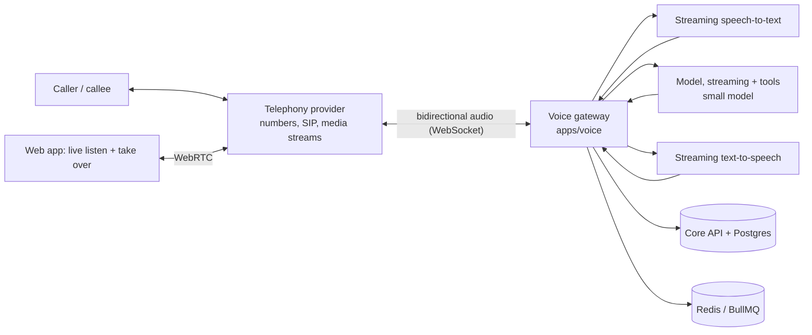
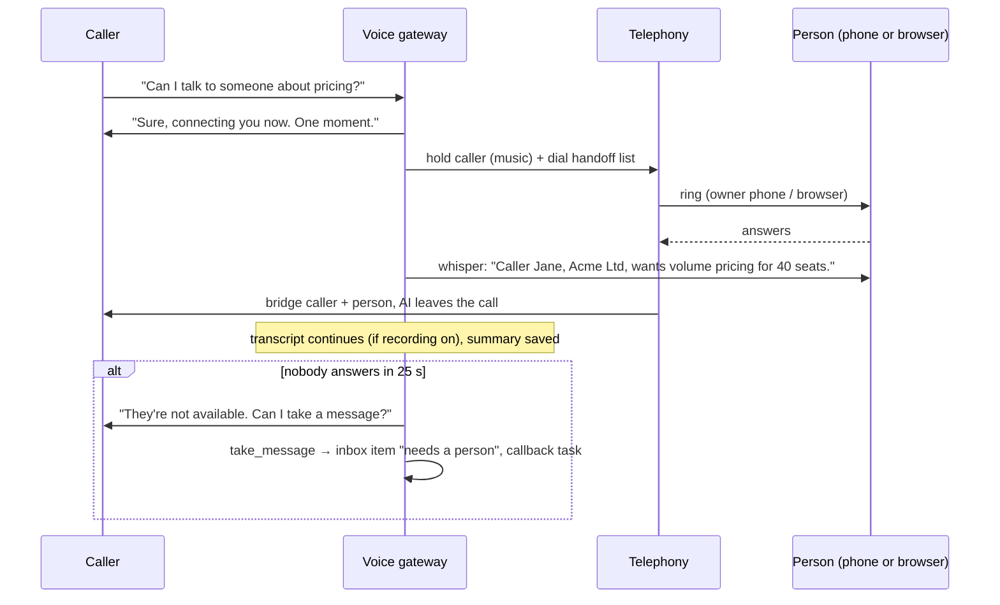

# Voice line (Sales Manager Staff)

Status: draft v1, 2026-10-29. In launch scope (decision D15).

Each Sales Manager Staff member can have its own phone number. It answers calls in the business's name, speaks
only from the company brain, books next steps, and hands the call to a person live whenever it should. With
recorded consent, it also places outbound calls.

## 1. What the caller experiences

1. **Greeting with disclosure and recording notice** (both always on):
   "Hi, you've reached Acme. I'm Ada, Acme's AI assistant. This call may be recorded. How can I help?"
2. **Conversation:** it answers questions from facts only, qualifies the caller (need, size, timing), and collects
   their name and email.
3. **Outcome**, one of:
   - **book**: sends the booking link by email and confirms out loud;
   - **message**: takes a message for the team;
   - **transfer**: hands over to a person live (see §4);
   - **end**: politely ends the call (wrong number, spam, opt-out).
4. **After the call:** the transcript, a summary, the outcome and next step are attached to the lead's conversation.
   A new caller becomes a lead (`source = call`).

## 2. Scope

| Capability | Included | Notes |
|---|---|---|
| Local number per staff member | Yes | Countries in phase A: US, CA, UK. Others added as their regulatory paperwork is supported (§7) |
| Bring your own number (forward to ours) | Yes | Customer forwards their existing line; no porting at launch |
| Inbound AI answering | Yes | Business hours and after-hours behaviour configurable |
| Live transfer to a person's phone | Yes | Warm transfer with spoken summary ("whisper") |
| Take over from the browser | Yes | Owner listens live in the web app and clicks "Take over" (WebRTC) |
| Voicemail and messages | Yes | When no person answers a transfer, or outside hours if configured |
| Outbound calls to consented leads | Yes | Consent gating, calling hours and do-not-call checks are enforced in code (§6) |
| Outbound cold calls to leads without consent | **No, never** | Legal exposure in the US (TCPA) and elsewhere |
| SMS | No (later) | US A2P 10DLC registration; booking links go by email instead |
| Languages | English | |

## 3. Architecture

- **Voice gateway (`apps/voice`)** is a separate deployable. It is stateful per call and scales on concurrent calls.
  Everything else stays in the API and workers. It loads a **call context** at call start (company facts, staff
  settings, lead and conversation if known), runs the turn loop, and writes events.
- **Cascaded pipeline (streaming STT → LLM → streaming TTS)**, not a single speech-to-speech model, at launch.
  This gives per-turn tool calls, the same guardrails as text, transcripts for free, and swappable vendors.
  Speech-to-speech is reconsidered when vendors offer tool use plus transcripts at lower latency (DECISIONS Q10).
- **Turn handling:** voice activity detection and end-of-turn detection; barge-in (the caller can interrupt, and
  TTS stops within 200 ms); filler phrases while a tool runs ("one moment").
- **Tools the model can call during a call:** these return effects, as in the role framework.
  - `lookup_fact(topic)`
  - `capture_contact(name, email, company)`
  - `send_booking_link(email)`
  - `take_message(text)`
  - `transfer(reason)`
  - `end_call(reason)`
  - `mark_opt_out()`

  The gateway executes them; the model never dials, emails or writes data directly.

### Latency budget (caller stops speaking → first audio back)

| Step | Target |
|---|---|
| End-of-turn detection | ≤ 300 ms |
| STT final | ≤ 150 ms |
| LLM first token | ≤ 350 ms |
| TTS first audio | ≤ 150 ms |
| Network and telephony | ≤ 150 ms |
| **Total** | **≤ 1.1 s (p50), ≤ 1.6 s (p95)** |

Hosted in the same region as the telephony provider's media edge. The model is a small, fast tier. Prompts stay
short, with company facts preloaded into the call context.

### Vendors (chosen in milestone 0, behind interfaces)

| Interface | Candidates to evaluate |
|---|---|
| `TelephonyProvider` (numbers, calls, media streams, transfer, WebRTC client) | Twilio, Telnyx, Vonage |
| `SpeechToText` (streaming) | Deepgram, AssemblyAI, provider-native |
| `TextToSpeech` (streaming, low latency) | ElevenLabs, Cartesia, provider-native |
| Model | Anthropic small model (streaming + tool use) behind `ModelProvider` |

Selection criteria: p95 latency measured from our region; per-minute cost; number coverage and regulatory
API; data terms (no training on our audio); SLA.

## 4. Handoff to a person

- **Handoff list:** an ordered list of phone numbers and/or web users, with business hours. Rings in sequence or all
  at once (configurable).
- **Always transfer when:** the caller asks for a person; anything listed in `escalateWhen` (discounts, contracts, legal,
  complaints); the AI fails to understand twice in a row; the caller sounds upset (sentiment flagged by the model).
- **Take over from the browser:** an owner watching the live transcript clicks "Take over". The AI says a hand-off line
  and drops; the owner's browser audio is bridged in.

## 5. Inbound flow

1. Telephony webhook `call.incoming` → API checks the number → workspace and staff member. Checks entitlement, spend
   (reserve 5 minutes, extended in 5-minute blocks), staff state and business hours.
2. Not allowed (paused, over cap, after hours with "message only") → recorded message and voicemail.
3. Allowed → media stream opens to the voice gateway → greeting → turn loop.
4. Hard limits: 20 minutes maximum per call (configurable down), silence timeout of 30 s, and a platform kill switch
   that ends calls gracefully.
5. Call ends → `call.ended` event → a worker builds the transcript, summary, outcome and lead update, settles the spend, and
   counts work units (minutes) → activity log.

## 6. Outbound calls (consent-gated)

An outbound call task (`sales.call_lead`) only runs when **all** of these hold, checked in code before dialling:

- **Consent:** a `call_consents` record for that number. It holds the source (web form with consent text, inbound caller who
  asked for a callback, or a reply saying "call me"), the exact wording shown, a timestamp and evidence. A consent can
  be withdrawn at any time ("don't call me", or an opt-out on any channel).
- **Do-not-call:** the number isn't on the workspace DNC list or the platform DNC list. The workspace must declare
  that it has checked national registries where required (US National DNC, UK TPS/CTPS). A registry-check provider
  integration is open question Q12.
- **Calling hours:** inside the recipient's local calling window (default 09:00–20:00 local, stricter where the law requires), and not on
  public holidays where known.
- **Limits:** a per-day outbound cap per number, at most 3 attempts per lead per 7 days, and no repeat call after a
  "not interested".
- **Caller ID:** the workspace's own number with verified caller ID (STIR/SHAKEN attestation via the provider).
- **Opening:** AI disclosure, the business name and the reason for the call ("you asked us to call you about…"),
  plus an immediate opt-out ("If you'd rather not be called, just say so").
- **Autonomy:** `sales.call_lead` defaults to `draft`. The owner approves each call, or approves a "call list". Promotion is
  allowed after 20 approved calls with no complaints.

## 7. Phone numbers

- Provisioned through the provider's API in the workspace's chosen country and area code.
- Regulatory information is collected in-app where the country requires it (business name, address, ID documents), and
  submitted via the provider's regulatory API. The number becomes active once approved (this can take days).
- One number is included per Sales Manager seat; extra numbers are a billed add-on.
- On cancellation, a number is kept for 30 days (so the customer can return), then released.
- Number health: answer rate, spam-label monitoring where the provider offers it, and complaint tracking.

## 8. Recording, transcripts and privacy

- The recording notice is always played. Recording itself can be switched off per workspace. Transcripts are still created
  live for the summary, then deleted after the summary if the owner chooses "no transcripts".
- Audio is stored encrypted in object storage for 30 days by default (configurable 0–90). Transcripts follow message
  retention.
- Customers can delete a caller's data (data subject request) in one action.
- Vendors are listed as sub-processors. No training on our audio (contract terms are checked in M0).

## 9. Tests and quality

- **Simulated-caller harness:** scripted and LLM-driven callers run through the gateway with recorded audio fixtures.
  It covers: pricing beyond offers → transfer; opt-out; an off-topic attempt to jailbreak the AI; silence; barge-in; a noisy line; and an angry caller.
- **Latency regression test** in CI against the provider sandbox (nightly).
- **Eval scores per call:** factual accuracy, escalation correctness, disclosure present, and outcome recorded.
